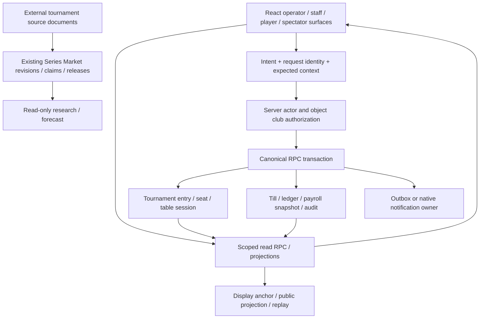

# Architecture comparison

Evidence IDs E01–E48 in [03](03_SKILL_BY_SKILL_CODE_AUDIT.md), VinPoker V01–V28 in [02](02_VINPOKER_CAPABILITY_INVENTORY.md). Không có measured performance/production comparison. “Tốt hơn” dưới đây chỉ áp dụng cho contract cụ thể có source evidence, không phải whole product.

## Domain and trust-boundary map

Đây là contract direction trace từ các canonical source paths; **không phải khẳng định tất cả UI caller hiện tại đã đi qua Tx**. Legacy tournament config V03/V04 vẫn có separate writes, một số RPC bodies chỉ có archive source. Những khác biệt đó là findings, không được che bằng sơ đồ.

## Comparison by mechanism

| Axis | VinPoker source | External evidence | Kết luận áp dụng |
|---|---|---|---|
| Scope/identity | Club/player/entry/table/session/assignment riêng; newer RPC derive actor from auth.uid (V07/V08/V10/V11) | B1 local player objects; B3 per-player counters; B5 nickName/rank lists; B2 global permission + event model | Giữ exact entry/session identity; không dùng name hay rebuy count làm canonical ID |
| Transaction authority | Floor plan/commit, clock start and receipt-based chip/cashier source; legacy draft/config writes chưa atomic | B1/B3/B4 client state; B5 individual Mongo updates; A5 controller memory + history writes | Học test cases; không port mutable local balances/seat authority |
| Authentication | Edge user verification; newer user-bound RPCs; legacy scope/payroll source cần kiểm tra ACL | A5 verified player action; B2 Django/DRF but template routes differ; B5 middleware gaps | “Login exists” không đủ; test actor + object club + role + action + revoked membership |
| Authorization/RLS | Policies/definer guards/ACL explicit ở newer functions; active versus archived source cần reconcile | A1 Commander upstream unknown; Arena handlers không tương đương DB RLS proof | Không gọi whole repo secure; verify function hash/owner/search_path/grants/policies khi đúng scope |
| Concurrency | Expected revision/context + same request receipts; V08 deferred Tracker moves | Pulse occupancy move assumes one mutable array; Arena SELECT/COUNT/INSERT; B5 repeated append | Giữ locks/fences; no direct auto-port balancing into live hand |
| Idempotency | Actor/key/payload binding + durable receipts in V10/V11 | A5 optional header row unique check; B5 no meaningful replay fence | Optional duplicate rejection không thay replay-safe outcome recovery |
| Timing | Server clock RPC + monotonic anchor + visibility/reconnect refresh V05/V06 | Pulse/Royal one decrement per tick | VinPoker contract stronger under delayed browser ticks; real sleep/wake drift still needs measurement |
| Persistence/recovery | Postgres snapshots/audit, explicit unknown/error state, public projections | Java object serialization, browser localStorage, remote Electron wrapper | Local storage useful for drafts/display prefs, not operating ledger |
| Payout | Real-function conservation/monotonic/determinism tests V23; server apply body incomplete in snapshot | B1 player multiplier; B3 fixed splits/flooring | Keep VinPoker calculator; independently qualify server application, never assume calculator test proves ledger |
| Realtime | Scoped snapshots, request generation fence, cleanup/reconnect in V06/V22 | A3 callback stub; Royal cross-tab atoms; Commander polling + upstream | Compare actual consumers; network/subscription cost NOT_MEASURED |
| Source provenance | Series Market document/revision/claim/correction/release V20 | Registry metadata + discovery/ingest tests A2 | Reuse existing VinPoker provenance; adopt challenge/empty/redirect negative tests |
| UX | Multiple role surfaces and disabled controls have source; customer queue exists | Commander explicit join/arrival; Pulse projector/operator split | Study workflows, benchmark steps with actual users; no faster UI claim from screenshot |
| Testing | Contract/static, imported TS unit tests, PG17 SQL/concurrency harness, E2E source V27 | Pulse mixed real-import/helper-local tests; A2 offline/DB cases; B1/B4/B6 little test source | Evaluate test seams, not file count; suites not executed here |
| Observability | Source-health availability, money-state/freshness, ingest audit, release manifests | A1 proxy boundary; A2 source URLs; desktop app wrapper | Build from existing signals; no new telemetry platform for this research |
| Deployment | Frontend/DB/Edge/flag are independent evidence layers | README/deployment docs and workflows don't prove deployed services | No runtime superiority/production status granted from source |

## Functional comparison by module

| Module | External strength proven at source | VinPoker strength to retain | Actual gap or verification task |
|---|---|---|---|
| Club operations | B2 participant model, A1 customer waitlist UI | Multi-role pages/club scope; newer object-derived authority | Legacy cashier scope lookup needs current actor/ACL verification |
| Dealer/workforce | None of B1–B6 provides equivalent dealer rotation/payroll scope | Exact assignment/session lifecycle, scheduling, attendance, secure payroll mutations | Ongoing session owns forecast close; audit source/archive provenance after handoff |
| Tournament setup | B1 simple draw; B3 operator/projector UX | Multi-day RPC, blind presets, clock start server boundary | Standard draft/config separate writes; canonical create RPC may be reused/extended after contract map |
| Floor/table balance | B1 duplicate-seat checks; B3 occupancy-gap heuristic | Existing balanced break planner, expected revision/plan hash, locked/deferred moves | Explain plan and qualify constraints; do not build missing “auto-balance” based on filename search |
| Cashier/finance | No surveyed external system proves comparable money controls | Till/refund ledgers, actor-bound newer mutations, payment ingest separation | Finance summary parser can treat malformed success payload as zero; runtime impact unknown |
| Player CRM/waitlist | A1 waitlist sequence, B2 check-in/member objects | Entry vs player identity, existing registration/contact/club records | Dedicated waitlist stub; CRM identity integration needs contract-only audit before feature |
| Intelligence | A2 ingestion failure test scenarios | Existing claim lineage, partial/stale markers, digest read model/automation source | Editorial events provenance bridge, current deployed read-source contracts |
| Online/replay | A5 explicit engine/controller; A4 seat layout implementation | Server views/private cards/canonical action path, separate Tracker replay | Whole game architecture replacement not justified; runtime/capacity unverified |
| Staff desktop | B6 isolated preload/Electron prefs | Browser/PWA avoids separate binary update maintenance | No measured kiosk need; Electron wrapper adds cost and no demonstrated offline resilience |

## Data contracts before integration

1. **Employee:** inventory `dealers`, `staff_members`, linked auth identity, attendance, approved shifts and immutable payroll/statement source. Per-club linked-user constraints exist in archived staff definition; do not infer live duplicates or invent global employee table. Read-only view only after identity/scope/privacy/reproducibility gates.
2. **Player:** auth identity/club membership/contact consent differs from tournament entry. A waitlist ticket is not a seat/payment entitlement; opaque ticket IDs, server-derived club, expiry/arrival lifecycle and audit required.
3. **Tournament:** game table physical asset, tournament_table link and table_session lifecycle are distinct. Draft/setup config cannot delete/reassign live links as an incidental UI request. A balancing preview is advisory until canonical commit checks current version/locks/hand state.
4. **Finance:** bank event is evidence of a transfer, not necessarily confirmed buy-in; prize pool/escrow are liabilities, not revenue. Do not recalculate paid payroll from attendance; use locked records/statement snapshots.
5. **Source ingestion:** external facts are research/editorial data, not canonical live operational tournaments. Store source revision and review status; stale/ambiguous/challenge pages produce unavailable, not authoritative zero.

## Design choices deliberately rejected

No full rewrite, no Gauzy-like new HRM schema, no desktop packaging without measured need, no copied tournament/payment engine, no automatic scrapers/AI operations, no imported source-project UI rules. Keeping one domain source of truth is more valuable than adopting a tool name. Implementation/API architecture of upstream Commander remains outside accessible source scope.

License and terms are independent: permissible code use does not authorize scraping a service or processing player data. Vietnam-specific legal/commercial conclusions and provider cost estimates require separate current expert/source verification; this audit makes no legal or price claims.
